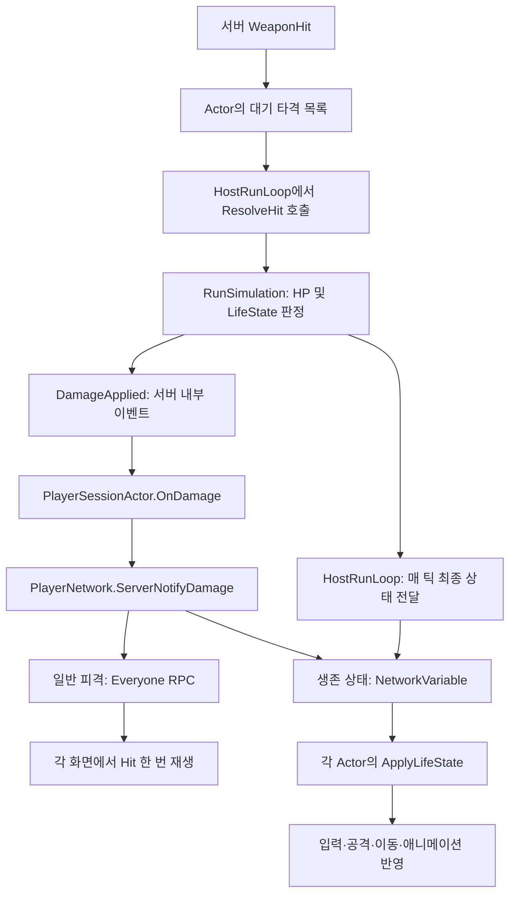

# PlayerSessionActor 플레이어 피격·다운·사망 구현 가이드

작성일: 2026-11-02  
기준: 현재 작업 폴더의 코드, Unity 6000.3.6f1, Netcode for GameObjects 2.13.3

이 문서는 **구현 제안서**입니다. 문서의 코드를 실제 프로젝트에 적용한 상태는 아닙니다. 현재 수정 중인 작업 파일을 기준으로 조사했으며, 신입 개발자가 변경 이유와 적용 위치를 함께 이해할 수 있도록 작성했습니다.

대상 파일은 `Assets/GameResource/Scripts/Object/Character/Player/PlayerSessionActor.cs`입니다. 이 문서에서 `Assets/...`는 `D:/Unity/Dungeon-Abyss-Project/Dungeon-Abyss-Project` 아래의 경로를 뜻합니다. 코드 블록마다 **파일 전체 교체**, **메서드 교체**, **클래스 내부 추가**를 구분합니다. 메서드 교체는 기존 같은 이름의 메서드를 지우고 넣는다는 뜻입니다.

## 1. 구현할 동작과 제안 규칙

**서버가 HP와 생존 상태를 결정하고, PlayerSessionActor는 그 결과를 입력·이동·공격·애니메이션에 반영합니다.** 클라이언트 Actor에서 HP를 다시 차감하지 않습니다.

현재 코드에는 다운까지의 판정만 있고, 다운 이후 언제 사망하는지에 대한 규칙은 없습니다. 아래는 이 문서의 예제를 완결하기 위해 정한 **제안 규칙이며 확정된 게임 기획이 아닙니다.**

| 상황 | 서버 판정 | 화면과 조작 결과 |
|---|---|---|
| 피해 후 HP가 남음 | Alive 유지 | Hit 연출 요청 전달. 이동·공격을 강제로 중단하는 경직은 없음 |
| 피해 후 HP가 0 | Alive → Down | 입력 차단, 이동 연출 정지, 진행 중 공격과 대기 타격 취소 |
| 다른 Alive 플레이어가 있는 동안 다운 15초 경과 | Down → Dead | 사망 애니메이션, 행동 차단 유지 |
| 참가 플레이어 중 Alive가 한 명도 없음 | 남은 Down → Dead, 이후 PartyDown | 파티 전멸 처리 |
| 늦게 접속해 이미 Down/Dead인 플레이어를 봄 | 현재 생존 상태 동기화 | 해당 상태를 바로 표시. 과거 Hit는 재생하지 않음 |

다운과 사망은 모두 HP가 0일 수 있습니다. 따라서 `HP <= 0`이나 기존 `DownOrDead` 하나만으로 두 상태를 구별하면 안 됩니다. 이미 정의된 `LifeState.Alive`, `Down`, `Dead`, `Absent`를 사용합니다. `Absent`는 슬롯에 참가자가 없거나 네트워크 초기화가 끝나지 않은 상태입니다.

이 예제에서 일반 피격은 **시각적 반응**입니다. 피격 무적 시간, 넉백, 서버 경직 시간, 부활 상호작용, 관전 카메라, 시체 제거는 구현 범위에 포함하지 않습니다. 다운/사망 시에는 공격을 실제로 취소합니다. `RunRules.ReviveHpRatio`가 이미 있어도 부활 기능이 구현되어 있다는 뜻은 아닙니다.

혼자 플레이하다 HP가 0이 되면 곧바로 전멸 조건이 성립하여 최종 상태는 Dead입니다. 여러 상태가 같은 네트워크 틱에 바뀌면 원격 화면에는 최종 Dead만 전달될 수 있으므로, 모든 상황에서 Down 애니메이션이 먼저 끝날 것이라고 가정하지 않습니다.

## 2. 현재 코드에서 확인한 연결과 빈 부분

| 파일 / 메서드 | 현재 동작 | 필요한 변경 |
|---|---|---|
| `PlayerSessionActor.OnDamage` | 대상 종류와 슬롯만 검사 | 서버 결과를 PlayerNetwork로 전달 |
| `RunSimulation.ApplyDamage` | HP 차감 후 Down 설정 | 생존 상태 공통 변경 함수 사용, 결과에 명확한 상태 포함 |
| `RunSimulation.TryPartyDown` | Alive가 없으면 PartyDown | 먼저 Down을 Dead로 확정 |
| `PlayerNetwork.PlayHitRpc` | 호출부 없음, NotOwner 대상 | 서버만 호출하는 Everyone RPC로 교체 |
| `PlayerNetwork._vitals` | Owner만 읽음 | 그대로 유지. 공개 생존 상태를 별도 NetworkVariable로 추가 |
| `PlayerNetwork.FixedUpdate` | 소유자는 언제나 로컬 이동 | Alive 소유자만 로컬 이동, Down/Dead 소유자는 서버 위치 반영 |
| `HostRunLoop.FixedUpdate` | Pose/Vitals, 공격 승인 전달 | 매 틱 최종 LifeState 전달 |
| `PlayerAnimationController.PlayHit` | Hit Trigger 설정 | Animator에 실제 파라미터와 State 추가 |
| `CombatController.CancelAttack` | 공격 플래그와 판정창 초기화 | 이미 있으므로 그대로 재사용 |

`RunSession.OnNetworkSpawn()`은 서버에서만 `RunState`, `RunEvents`, `RunSimulation`을 만듭니다. `GameSceneContext.SpawnJoinedPlayer()`의 `actor.Bind(_session.Events)`도 서버에서 호출됩니다. `RunEvents.DamageApplied`는 R3 이벤트로, 다른 컴퓨터에 자동 전송되는 이벤트가 아닙니다.



**RPC**는 다른 컴퓨터의 메서드를 호출하는 메시지입니다. Hit처럼 잠깐 발생하는 사건에 사용합니다. **NetworkVariable**은 현재 값을 공유하는 변수입니다. Down/Dead처럼 유지되어야 하는 상태에 사용합니다. 초기 동기화 값은 `OnNetworkSpawn()`에서 직접 반영하고, 이후 변경은 `OnValueChanged`로 받습니다. [Unity 공식 저장소의 NetworkVariable 설명](https://github.com/Unity-Technologies/com.unity.netcode.gameobjects/blob/develop-3.x.x/com.unity.netcode.gameobjects/Documentation~/basics/networkvariable.md)

## 3. 적용 순서와 파일 목록

아래 절의 코드는 하나의 구현안입니다. 의존하는 새 메서드가 있으므로 전체 변경을 적용한 뒤 Unity 컴파일을 확인합니다. 적용 중간에는 아직 추가하지 않은 메서드 때문에 오류가 날 수 있습니다.

1. `Object/Session/RunRules.cs`: 다운 제한 시간 추가.
2. `Object/Session/DamageApplied.cs`: 피해 후 생존 상태 추가.
3. `Object/Session/RunSimulation.cs`: 상태 전환과 사망 타이머 구현.
4. `Object/Character/Player/PlayerMovementController.cs`: 이동값 초기화 메서드 추가.
5. `Object/Character/Player/PlayerAnimationController.cs`: 생존 상태 연출 구현.
6. `Object/Character/Player/PlayerSessionActor.cs`: 전체 반영 흐름 구현.
7. `Object/Character/Player/PlayerNetwork.cs`: 공개 상태와 피격 RPC 구현.
8. `Object/Session/HostRunLoop.cs`, `Object/Management/Scene/GameSceneContext.cs`: 호출 연결.
9. `Assets/GameResource/Animation/Animator/PlayerAnimator.controller`: 파라미터, State, Transition 구성.

`PlayerVital`, `PlayerPose`, `LocalPlayerInput`, `PlayerCombatController`, `CombatController`는 이 구현을 위해 수정할 필요가 없습니다.

## 4. 피해 결과에 정확한 생존 상태 담기

### 4.1 RunRules 클래스 내부 추가

```csharp
// 기획에서 조절할 값. 현재 프로젝트에 있던 규칙이 아니라 이 문서의 제안이다.
public const float BleedOutSeconds = 15f;
```

### 4.2 DamageApplied 구조체만 교체

파일: `Assets/GameResource/Scripts/Object/Session/DamageApplied.cs`

기존 `DdaIT.Object.Session` 네임스페이스 안의 `DamageApplied`만 아래로 교체합니다. 같은 파일의 `DoorOpened`, `ItemPicked`는 유지합니다.

```csharp
public readonly struct DamageApplied
{
    public readonly int AttackerSlot;
    public readonly int TargetKind;
    public readonly int TargetId;
    public readonly float Amount;
    public readonly float HpAfter;
    public readonly LifeState LifeStateAfter;

    // 기존 조회 코드와의 호환용. Down과 Dead의 구별에는 사용하지 않는다.
    public readonly bool DownOrDead;

    public DamageApplied(
        int attackerSlot,
        int targetKind,
        int targetId,
        float amount,
        float hpAfter,
        LifeState lifeStateAfter)
    {
        AttackerSlot = attackerSlot;
        TargetKind = targetKind;
        TargetId = targetId;
        Amount = amount;
        HpAfter = hpAfter;
        LifeStateAfter = lifeStateAfter;
        DownOrDead = lifeStateAfter == LifeState.Down ||
                     lifeStateAfter == LifeState.Dead;
    }
}
```

`readonly`는 이벤트를 만든 뒤 결과를 바꾸지 못하게 합니다. 이 구조체는 서버 내부에서만 전달하므로 `INetworkSerializable`을 붙일 필요가 없습니다. 네트워크에는 뒤에서 생존 상태와 Hit 메시지를 별도로 보냅니다. 생성자 마지막 인자의 타입이 바뀌므로 기존 생성 호출도 5.3절처럼 함께 고쳐야 합니다.

## 5. RunSimulation: 서버가 다운과 사망을 결정하기

파일: `Assets/GameResource/Scripts/Object/Session/RunSimulation.cs`

### 5.1 필드와 보조 메서드를 클래스 내부에 추가

```csharp
// 슬롯별 다운 잔여 시간. 클라이언트에서 따로 계산하지 않는다.
private readonly float[] _downRemaining = new float[RunRules.MaxPlayer];

public void ResetPlayerTimers(SlotId slot)
{
    if (!_authority.IsHost || slot.Value >= _downRemaining.Length)
        return;

    _downRemaining[slot.Value] = 0f;
    _attackCoolDown[slot.Value] = 0f;
}

private void SetPlayerLifeState(int index, LifeState next)
{
    ref var player = ref _state.Players[index];
    if (player.LifeState == next)
        return;

    player.LifeState = next;
    player.AnimationParams.LifeState = next;
    _downRemaining[index] = next == LifeState.Down
        ? RunRules.BleedOutSeconds
        : 0f;

    if (next == LifeState.Down || next == LifeState.Dead)
        player.Combat.Hp = 0f;

    if (next != LifeState.Alive)
    {
        // 같은 틱에 이미 승인됐던 공격과 이전 이동 연출을 지운다.
        player.Aiming = false;
        player.AnimationParams.IsAiming = false;
        player.AnimationParams.MoveDirection = Vector3.zero;
        player.AnimationParams.SpeedRatio = 0f;
        player.AnimationParams.AttackPulse = false;
    }
}

private void TickDownTimers(float deltaTime)
{
    bool someoneDied = false;

    for (int i = 0; i < _state.Players.Length; i++)
    {
        ref var player = ref _state.Players[i];
        if (!player.IsJoined || player.LifeState != LifeState.Down)
        {
            _downRemaining[i] = 0f;
            continue;
        }

        _downRemaining[i] = Mathf.Max(0f, _downRemaining[i] - deltaTime);
        if (_downRemaining[i] > 0f)
            continue;

        SetPlayerLifeState(i, LifeState.Dead);
        someoneDied = true;
    }

    if (someoneDied)
        TryPartyDown();
}
```

`ref var player = ref 배열[index]`는 배열 안의 구조체를 직접 수정하기 위한 문법입니다. `var player = 배열[index]`만 사용하면 복사본을 바꾸므로 배열에 다시 대입해야 합니다. 같은 상태가 반복 적용될 때 바로 반환하는 것은 다운 타이머가 매 틱 15초로 돌아가는 문제를 막습니다.

### 5.2 Tick 메서드 교체

```csharp
public void Tick(float deltaTime, CharacterCommand[] commands, int commandCount)
{
    if (!_authority.IsHost)
        return;

    // Playing이 끝났어도 지난 프레임의 공격 신호를 남기지 않는다.
    ClearAttackPulse();

    if (_state.phase != RunPhase.Playing)
        return;

    TickDownTimers(deltaTime);
    if (_state.phase != RunPhase.Playing)
        return;

    for (int i = 0; i < _attackCoolDown.Length; i++)
        _attackCoolDown[i] = Mathf.Max(0f, _attackCoolDown[i] - deltaTime);

    for (int i = 0; i < commandCount; i++)
        ApplyCommand(commands[i]);
}
```

타이머를 명령보다 먼저 처리하므로 이번 틱에 사망한 플레이어의 명령은 기존 `ApplyCommand()`의 Alive 검사에서 거절됩니다. 서버가 정한 고정 틱의 `deltaTime`을 사용합니다. 게임을 일시 정지하여 물리 틱이 멈추면 이 타이머도 멈추는 게임 시간 기준입니다.

### 5.3 ApplyDamage 메서드 교체

```csharp
private void ApplyDamage(
    in HitTarget attacker, in HitTarget target, float finalDamage)
{
    if (!_authority.IsHost || _state.phase != RunPhase.Playing)
        return;

    if (float.IsNaN(finalDamage) || float.IsInfinity(finalDamage) ||
        finalDamage <= 0f)
        return;

    // 현재 프로젝트의 플레이어 피해 경로를 유지한다.
    if (target.kind != HitTargetKind.Player)
        return;

    if (target.Id < 0 || target.Id >= _state.Players.Length)
        return;

    ref var player = ref _state.Players[target.Id];
    if (!player.IsJoined || player.LifeState != LifeState.Alive)
        return;

    player.Combat.Hp = Mathf.Max(0f, player.Combat.Hp - finalDamage);
    bool becameDown = player.Combat.Hp <= 0f;
    if (becameDown)
        SetPlayerLifeState(target.Id, LifeState.Down);

    _events.DamageApplied.OnNext(new DamageApplied(
        attackerSlot: attacker.kind == HitTargetKind.Player ? attacker.Id : -1,
        targetKind: (int)target.kind,
        targetId: target.Id,
        amount: finalDamage,
        hpAfter: player.Combat.Hp,
        lifeStateAfter: player.LifeState));

    if (becameDown)
        TryPartyDown();
}
```

`in`은 구조체 인자를 읽기 전용 참조로 전달하는 문법입니다. 여기서는 `HpAfter`가 확정된 현재 HP입니다. `Amount`는 계산된 공격 피해량이므로, 남은 HP보다 큰 공격에서는 실제 줄어든 HP보다 클 수 있습니다.

다운된 대상에 대한 추가 피해는 기존 규칙대로 거절합니다. 다운 중 추가 타격으로 즉시 처형하는 규칙을 원한다면 서버 판정과 `Actor.TryHit()` 조건을 함께 바꿔야 합니다.

### 5.4 TryPartyDown 메서드 교체

```csharp
private void TryPartyDown()
{
    bool hasJoinedPlayer = false;

    for (int i = 0; i < _state.Players.Length; i++)
    {
        ref var player = ref _state.Players[i];
        if (!player.IsJoined)
            continue;

        hasJoinedPlayer = true;
        if (player.LifeState == LifeState.Alive)
            return;
    }

    if (!hasJoinedPlayer)
        return;

    // PartyDown 이후에는 Tick의 타이머가 멈춘다.
    // 그러므로 전멸 시 남은 Down을 여기서 Dead로 확정한다.
    for (int i = 0; i < _state.Players.Length; i++)
    {
        if (_state.Players[i].IsJoined &&
            _state.Players[i].LifeState == LifeState.Down)
        {
            SetPlayerLifeState(i, LifeState.Dead);
        }
    }

    SetPhase(RunPhase.PartyDown);
}
```

`ResolveHit`, `ApplyCommand`, `TryAttack`, `TryInteract`, `ClearAttackPulse`, `SetPhase`, `StartRun`과 생성자는 유지합니다. `ResolveHit`의 공격자 Alive 검사도 유지해야 이미 수집한 타격 목록에 다운된 공격자의 타격이 남아 있어도 서버에서 거절할 수 있습니다.

현재 몬스터/월드 공격력 조회는 `ResolveHit`에 구현되어 있지 않습니다. 이 문서의 첫 검증은 기존 플레이어 간 타격 경로로 진행합니다. 몬스터 공격까지 자동 완성되는 변경은 아닙니다.

## 6. PlayerMovementController: 이동 정보를 명시적으로 지우기

파일: `Assets/GameResource/Scripts/Object/Character/Player/PlayerMovementController.cs`

클래스 내부에 다음 메서드를 추가합니다.

```csharp
public void StopMovement()
{
    _playerState = PlayerState.Idle;
    InputVector = Vector3.zero;
    MoveDirection = Vector3.zero;
    IsAiming = false;
    IsSprinting = false;
    SpeedRatio = 0f;

    if (_rigidbody != null && !_rigidbody.isKinematic)
    {
        // 입력으로 생긴 수평 이동을 멈추고 수직 낙하 속도는 보존한다.
        Vector3 velocity = _rigidbody.linearVelocity;
        _rigidbody.linearVelocity = new Vector3(0f, velocity.y, 0f);
        _rigidbody.angularVelocity = Vector3.zero;
    }
}
```

`ApplyLocal(default, dt)`만 호출하는 방식은 이전 `MoveDirection`으로 한 번 더 회전할 수 있습니다. 현재 `HandleRotation()`이 `HandleMovement()`보다 먼저 실행되기 때문입니다. 필요한 값을 직접 지우면 이 문제를 피할 수 있습니다.

이 메서드는 이동 입력과 수평 속도를 정리하는 역할입니다. Down/Dead의 최종 위치는 뒤의 `ApplyRemote()`가 서버 Pose로 맞춥니다. **공중 다운, 움직이는 발판, 시체 밀기까지 구현하려면 행동 불능 상태의 위치를 서버가 계속 시뮬레이션하는 기능이 별도로 필요합니다.** 현재 서버 위치는 Alive 명령으로 갱신되므로 본 예제의 기본 검증은 정지된 지면에서 진행합니다.

## 7. PlayerAnimationController 전체 교체

파일: `Assets/GameResource/Scripts/Object/Character/Player/PlayerAnimationController.cs`

아래 클래스는 11절의 Animator 설정과 한 쌍입니다. `Base Layer.Down`, `Base Layer.Dead`라는 이름의 State를 실제로 만들어야 합니다.

```csharp
using DdaIT.Object.Session;
using UnityEngine;

namespace DdaIT.Object.Character.Player
{
    public class PlayerAnimationController : AnimationController
    {
        private static readonly int SpeedHash = Animator.StringToHash("Speed");
        private static readonly int InputXHash = Animator.StringToHash("InputX");
        private static readonly int InputYHash = Animator.StringToHash("InputY");
        private static readonly int AimHash = Animator.StringToHash("IsAiming");
        private static readonly int HitHash = Animator.StringToHash("Hit");
        private static readonly int AttackHash = Animator.StringToHash("Attack");
        private static readonly int LifeHash = Animator.StringToHash("LifeState");

        private static readonly int LocomotionState =
            Animator.StringToHash("Base Layer.Locomotion");
        private static readonly int DownState =
            Animator.StringToHash("Base Layer.Down");
        private static readonly int DeadState =
            Animator.StringToHash("Base Layer.Dead");
        private static readonly int EmptyAttackState =
            Animator.StringToHash("Attack.Empty");

        private LifeState _lifeState = LifeState.Absent;
        private bool _hasLifeState;
        private int _attackLayer = -1;
        private float _aliveAttackWeight = 1f;

        protected override void Awake()
        {
            base.Awake();
            _attackLayer = _animator.GetLayerIndex("Attack");
            if (_attackLayer >= 0)
                _aliveAttackWeight = _animator.GetLayerWeight(_attackLayer);
        }

        public void ApplyLifeState(LifeState state)
        {
            if (_hasLifeState && _lifeState == state)
                return;

            _hasLifeState = true;
            _lifeState = state;
            _animator.SetInteger(LifeHash, (int)state);
            _animator.ResetTrigger(HitHash);
            _animator.ResetTrigger(AttackHash);
            ResetLocomotionParameters();

            // Trigger 초기화만으로는 재생 중인 Attack State가 끝나지 않는다.
            // 현재 공격 State를 Empty로 옮기고 비생존 상태에서는 레이어를 숨긴다.
            if (_attackLayer >= 0)
            {
                _animator.Play(EmptyAttackState, _attackLayer, 0f);
                _animator.SetLayerWeight(
                    _attackLayer, state == LifeState.Alive ? _aliveAttackWeight : 0f);
            }

            switch (state)
            {
                case LifeState.Alive:
                    _animator.CrossFadeInFixedTime(LocomotionState, 0.08f, 0, 0f);
                    break;
                case LifeState.Down:
                    _animator.CrossFadeInFixedTime(DownState, 0.08f, 0, 0f);
                    break;
                case LifeState.Dead:
                    _animator.CrossFadeInFixedTime(DeadState, 0.08f, 0, 0f);
                    break;
                // Absent는 초기화 대기 상태. 새로운 동작을 시작하지 않는다.
            }
        }

        public void Apply(in CharacterPresentation p, float dt)
        {
            if (_lifeState != LifeState.Alive)
            {
                ResetLocomotionParameters();
                return;
            }

            SetAnimationBool(AimHash, p.IsAiming);
            if (p.IsAiming)
            {
                Vector3 local = transform.InverseTransformDirection(p.MoveDirection);
                SetAnimationFloat(InputXHash, local.x, 0.1f, dt);
                SetAnimationFloat(InputYHash, local.z, 0.1f, dt);
                SetAnimationFloat(SpeedHash, 0f, 0.1f, dt);
            }
            else
            {
                SetAnimationFloat(SpeedHash, p.SpeedRatio, 0.15f, dt);
                SetAnimationFloat(InputXHash, 0f, 0.1f, dt);
                SetAnimationFloat(InputYHash, 0f, 0.1f, dt);
            }
        }

        public void PlayHit()
        {
            if (_lifeState != LifeState.Alive)
                return;

            // 일반 피격은 연출만 한다. 공격 판정/입력을 취소하지 않는다.
            _animator.SetTrigger(HitHash);
        }

        private void ResetLocomotionParameters()
        {
            _animator.SetBool(AimHash, false);
            _animator.SetFloat(SpeedHash, 0f);
            _animator.SetFloat(InputXHash, 0f);
            _animator.SetFloat(InputYHash, 0f);
        }
    }
}
```

`StringToHash()`는 Animator의 문자열 이름을 정수 식별자로 바꿉니다. 이름이 다르면 다른 식별자가 되므로 대소문자와 레이어 경로가 정확해야 합니다. `CrossFadeInFixedTime(..., 0.08f, ...)`의 전환 시간은 초 단위입니다. [Unity 공식 API](https://docs.unity3d.com/6000.3/Documentation/ScriptReference/Animator.CrossFadeInFixedTime.html)

`_hasLifeState`는 첫 적용을 보장하고, 같은 상태의 반복 적용은 무시합니다. 이를 빼면 매 틱 넘어지는 애니메이션의 첫 장면만 반복될 수 있습니다. 늦게 접속한 화면에서는 Down/Dead 클립을 처음부터 재생하며, 이미 진행된 애니메이션의 재생 시간까지 동기화하는 구현은 아닙니다.

## 8. PlayerSessionActor 전체 교체: 핵심 반영 코드

파일: `Assets/GameResource/Scripts/Object/Character/Player/PlayerSessionActor.cs`

`CharacterPresentation` 구조체도 포함한 파일 전체 교체 예시입니다. 기존 외부 호출 메서드인 카메라, 슬롯, Perception, Pose 관련 메서드를 유지합니다.

```csharp
using System;
using System.Collections.Generic;
using DdaIT.Object.Session;
using DdaIT.Util;
using R3;
using UnityEngine;

namespace DdaIT.Object.Character.Player
{
    public struct CharacterPresentation
    {
        public Vector3 MoveDirection;
        public float SpeedRatio;
        public bool IsAiming;
    }

    [RequireComponent(typeof(PlayerNetwork))]
    public class PlayerSessionActor : CachedMonobehaviour, IHitReceiver
    {
        [SerializeField] private byte _slotValue;
        [SerializeField] private LocalPlayerInput _input;
        [SerializeField] private PlayerMovementController _movement;
        [SerializeField] private PlayerCombatController _combat;
        [SerializeField] private PlayerAnimationController _animation;
        [SerializeField] private PlayerPerceptionController _perception;

        private PlayerNetwork _network;
        private IDisposable _damageSub;
        private IDisposable _hitSub;
        private readonly List<HitTarget> _pendingHits = new();
        private bool _hasInputAuthority;
        private bool _gameplayInputEnabled = true;
        private bool _isServerBound;
        private bool _hasLifeState;
        private LifeState _lifeState = LifeState.Absent;

        public PerceptionController Perception => _perception;
        public SlotId Slot => new SlotId(_slotValue);
        public LifeState CurrentLifeState => _lifeState;
        public bool CanAct => _lifeState == LifeState.Alive;

        private void Awake()
        {
            _network = GetComponent<PlayerNetwork>();
        }

        // GameSceneContext가 서버에서 호출한다.
        // 서버의 RunEvents와 무기 타격 이벤트를 연결한다.
        public void Bind(RunEvents events)
        {
            if (_network == null || !_network.IsServer)
                return;

            Unbind();
            _isServerBound = true;
            _damageSub = events.DamageApplied.Subscribe(OnDamage);
            _hitSub = _combat.WeaponHit.Subscribe(OnWeaponHit);
            _combat.SetHitQuery(CanAct);
        }

        public void Unbind()
        {
            _damageSub?.Dispose();
            _damageSub = null;
            _hitSub?.Dispose();
            _hitSub = null;
            _isServerBound = false;
            _pendingHits.Clear();
            _combat.SetHitQuery(false);
            _combat.CancelAttack();
        }

        public void SetInputAuthority(bool hasAuthority)
        {
            _hasInputAuthority = hasAuthority;
            RefreshInputListening();
        }

        public void SetGameplayInputEnabled(bool enabled)
        {
            _gameplayInputEnabled = enabled;
            RefreshInputListening();
        }

        private void RefreshInputListening()
        {
            _input.SetListening(
                _hasInputAuthority && _gameplayInputEnabled && CanAct);
        }

        public void ApplyLifeState(LifeState state)
        {
            if (_hasLifeState && _lifeState == state)
                return;

            _hasLifeState = true;
            _lifeState = state;

            // 상태 전환 시 이전 공격과 아직 처리하지 않은 타격을 정리한다.
            _combat.CancelAttack();
            _pendingHits.Clear();
            _movement.StopMovement();
            _combat.SetHitQuery(_isServerBound && CanAct);

            RefreshInputListening();
            _animation.ApplyLifeState(state);
        }

        public CharacterCommand TickLocal(float deltaTime)
        {
            bool canReadInput =
                _hasInputAuthority && _gameplayInputEnabled && CanAct;

            LocalInputSnapShot snap = default;
            if (canReadInput)
            {
                snap = _input.Consume();
                _movement.ApplyLocal(snap, deltaTime);
            }
            else
            {
                _movement.StopMovement();
            }

            ApplyPresentation(deltaTime);

            return new CharacterCommand
            {
                SlotId = Slot,
                Position = _movement.SimulationPosition,
                MoveDirection = _movement.MoveDirection,
                Sprint = snap.Sprint,
                Aim = snap.Aim,
                AttackPressed = snap.AttackPressed && snap.Aim,
                InteractPressed = snap.InteractPressed,
                Yaw = _movement.SimulationYaw,
                SpeedRatio = _movement.SpeedRatio,
            };
        }

        private void ApplyPresentation(float deltaTime)
        {
            _animation.Apply(new CharacterPresentation
            {
                MoveDirection = _movement.MoveDirection,
                SpeedRatio = _movement.SpeedRatio,
                IsAiming = _movement.IsAiming,
            }, deltaTime);

            PushSimulationPoseFromMovement();
        }

        public void ApplyRemote(in PlayerPose pose, float deltaTime)
        {
            // 다운/사망 중에도 위치 보정을 받고 이동 연출값만 차단한다.
            if (!CanAct)
                _movement.StopMovement();

            _movement.ApplyReplicated(
                pose.Position,
                pose.Yaw,
                CanAct ? pose.MoveDirection : Vector3.zero,
                CanAct && pose.IsAiming,
                CanAct ? pose.SpeedRatio : 0f,
                deltaTime);

            ApplyPresentation(deltaTime);
        }

        public void PlayRemoteAttack(bool canDetectHits)
        {
            // 늦게 도착한 공격 승인으로 다운 상태에서 공격하지 않도록 한다.
            if (!CanAct)
                return;

            _combat.SetHitQuery(canDetectHits && _isServerBound);
            _combat.TryPlayAttack();
        }

        public void PlayRemoteHit()
        {
            // 오래된 Hit 메시지가 Down/Dead 애니메이션을 덮지 않도록 한다.
            if (CanAct)
                _animation.PlayHit();
        }

        private void OnDamage(DamageApplied e)
        {
            if (!_isServerBound || _network == null || !_network.IsServer)
                return;

            if (e.TargetKind != (int)HitTargetKind.Player ||
                e.TargetId != _slotValue)
                return;

            // 여기서 HP를 차감하거나 PlayHit를 직접 호출하지 않는다.
            _network.ServerNotifyDamage(e);
        }

        public void DrainHit(List<HitTarget> hits)
        {
            if (_isServerBound && CanAct)
                hits.AddRange(_pendingHits);

            _pendingHits.Clear();
        }

        private void OnWeaponHit(Collider other)
        {
            if (!_isServerBound || !CanAct || other == null)
                return;

            // 자식 콜라이더에 맞아도 부모의 Actor를 찾는다.
            IHitReceiver receiver = other.GetComponentInParent<IHitReceiver>();
            if (receiver == null || !receiver.TryHit(this, out HitTarget hit))
                return;

            _pendingHits.Add(hit);
        }

        public bool TryHit(Component attacker, out HitTarget target)
        {
            target = default;
            if (!CanAct)
                return false;

            if (attacker != null && attacker.transform.IsChildOf(transform))
                return false;

            target = new HitTarget(HitTargetKind.Player, _slotValue);
            return true;
        }

        public void PushSimulationPoseFromMovement()
        {
            if (_perception == null || _movement == null)
                return;

            _perception.SetSimulationPose(
                _movement.SimulationPosition, _movement.SimulationRotation);
        }

        public void ApplySimulationPose(Vector3 position, float yawDegrees)
        {
            _perception?.SetSimulationPose(position, yawDegrees);
        }

        public void SetViewCamera(Camera camera) => _movement.SetCamera(camera);
        public void SetSlot(SlotId slotId) => _slotValue = slotId.Value;

        private void OnDestroy()
        {
            _damageSub?.Dispose();
            _hitSub?.Dispose();
        }
    }
}
```

### 8.1 각 방어 조건이 필요한 이유

- `TargetKind`와 `TargetId`는 **피해를 받은 대상**입니다. `AttackerSlot`을 비교하면 공격자가 피격 연출을 하는 오류가 납니다.
- `CanAct`는 서버에서 전달받은 생존 상태를 바탕으로 계산합니다. UI용 HP 값으로 별도 판정을 만들지 않습니다.
- `_gameplayInputEnabled`는 컷씬 등 기존 입력 잠금입니다. 다운 처리를 위해 이 값을 덮어쓰지 않고, 입력 조건에 `CanAct`를 추가합니다. 나중에 Alive로 돌아오더라도 컷씬 잠금은 유지됩니다.
- `LocalPlayerInput.SetListening(false)`는 이미 이동값과 대기 공격·상호작용 입력을 지웁니다. 동일 기능을 추가 구현할 필요가 없습니다.
- `_isServerBound`는 무기 타격 수집을 서버에만 허용합니다. 실제 네트워크 권한 검사는 `PlayerNetwork.IsServer`와 서버 Simulation에서도 수행합니다.
- `CancelAttack()`은 기존 API입니다. `AttackEnd()`는 내부에서 마지막 `OverlapHits()`를 실행할 수 있어 다운 시 취소 용도로 쓰면 안 됩니다.
- `Unbind()`는 네트워크 Despawn 때 구독을 끊습니다. GameObject가 즉시 파괴되지 않고 재사용되어도 예전 세션 이벤트가 남지 않게 합니다.

같은 틱에 다른 Actor가 먼저 대기 목록을 외부 버퍼로 꺼낸 경우 `_pendingHits.Clear()`만으로는 외부 버퍼까지 지우지 못합니다. 그래서 서버 `ResolveHit`가 공격자의 Alive 여부를 다시 확인하는 기존 검사가 필요합니다. 일반 피격은 경직 규칙이 아니므로 Alive 공격자의 이미 수집된 타격은 허용합니다.

## 9. PlayerNetwork 전체 교체: 모든 화면에 결과 전달

파일: `Assets/GameResource/Scripts/Object/Character/Player/PlayerNetwork.cs`

아래 코드는 기존 명령, 위치, HUD 연결을 포함한 전체 교체 예시입니다. 현재 프로젝트의 네임스페이스가 `DdaIT.Object.Character`인 점을 유지합니다.

```csharp
using DdaIT.Object.Character.Player;
using DdaIT.Object.Session;
using R3;
using Unity.Netcode;
using UnityEngine;

namespace DdaIT.Object.Character
{
    public class PlayerNetwork : NetworkBehaviour
    {
        [SerializeField] private PlayerSessionActor _actor;

        private readonly NetworkVariable<byte> _slot = new();
        private readonly NetworkVariable<PlayerPose> _pose = new();
        private readonly NetworkVariable<PlayerVital> _vitals = new(
            readPerm: NetworkVariableReadPermission.Owner);

        // 누구나 읽지만 서버만 수정한다. 처음에는 입력을 허용하지 않는다.
        private readonly NetworkVariable<LifeState> _lifeState = new(
            LifeState.Absent,
            NetworkVariableReadPermission.Everyone,
            NetworkVariableWritePermission.Server);

        private readonly Subject<PlayerVital> _vitalChanged = new();
        public PlayerVital Vitals => _vitals.Value;
        public Observable<PlayerVital> VitalChanged => _vitalChanged;
        public SlotId Slot => new SlotId(_slot.Value);

        private CharacterCommand _pending;
        private bool _hasCommand;
        private byte _assignedSlot;

        public override void OnNetworkSpawn()
        {
            _hasCommand = false;
            if (IsServer)
            {
                _slot.Value = _assignedSlot;
                _pose.Value = new PlayerPose
                {
                    Position = transform.position,
                    Yaw = transform.eulerAngles.y,
                };
                _lifeState.Value = LifeState.Absent;
            }

            _slot.OnValueChanged += OnSlotChanged;
            _vitals.OnValueChanged += OnVitalsChanged;
            _lifeState.OnValueChanged += OnLifeStateChanged;

            ApplySlot(_slot.Value);
            // 초기값은 변경 통지를 기다리지 않고 한 번 직접 적용한다.
            // 늦은 접속에서도 현재 상태를 즉시 반영한다.
            _actor?.ApplyLifeState(_lifeState.Value);
            RefreshInputAuthority();
        }

        public override void OnNetworkDespawn()
        {
            _slot.OnValueChanged -= OnSlotChanged;
            _vitals.OnValueChanged -= OnVitalsChanged;
            _lifeState.OnValueChanged -= OnLifeStateChanged;
            _hasCommand = false;

            if (_actor != null)
            {
                _actor.SetInputAuthority(false);
                _actor.Unbind();
                _actor.ApplyLifeState(LifeState.Absent);
            }
        }

        public override void OnGainedOwnership() => RefreshInputAuthority();
        public override void OnLostOwnership() => RefreshInputAuthority();

        private void RefreshInputAuthority()
        {
            _actor?.SetInputAuthority(IsSpawned && IsOwner);
        }

        private void FixedUpdate()
        {
            if (!IsSpawned || _actor == null)
                return;

            if (IsOwner && _actor.CanAct)
            {
                SubmitCommandRpc(_actor.TickLocal(Time.fixedDeltaTime));
                return;
            }

            // 원격 플레이어와 행동 불능인 로컬 플레이어는 서버 Pose를 따른다.
            _actor.ApplyRemote(_pose.Value, Time.fixedDeltaTime);
        }

        public bool TryConsumeCommand(out CharacterCommand command)
        {
            command = _pending;
            bool has = _hasCommand;
            _hasCommand = false;
            return has;
        }

        public void PrepareSlot(byte slot) => _assignedSlot = slot;

        private void OnVitalsChanged(PlayerVital oldValue, PlayerVital newValue)
        {
            _vitalChanged.OnNext(newValue);
        }

        private void OnSlotChanged(byte oldValue, byte newValue)
        {
            ApplySlot(newValue);
        }

        private void ApplySlot(byte slot)
        {
            _actor?.SetSlot(new SlotId(slot));
        }

        private void OnLifeStateChanged(LifeState oldValue, LifeState newValue)
        {
            if (newValue != LifeState.Alive)
                _hasCommand = false;

            _actor?.ApplyLifeState(newValue);
        }

        public void ServerSetPose(in PlayerPose pose)
        {
            if (!IsServer || !IsSpawned)
                return;
            _pose.Value = pose;
        }

        public void ServerSetVitals(in PlayerVital vitals)
        {
            if (!IsServer || !IsSpawned)
                return;
            _vitals.Value = vitals;
        }

        public void ServerSetLifeState(LifeState state)
        {
            if (!IsServer || !IsSpawned)
                return;

            _lifeState.Value = state;
        }

        public void ServerNotifyDamage(in DamageApplied damage)
        {
            if (!IsServer || !IsSpawned)
                return;

            if (damage.TargetKind != (int)HitTargetKind.Player ||
                damage.TargetId != Slot.Value)
                return;

            ServerSetLifeState(damage.LifeStateAfter);

            // 치명타는 Hit 대신 Down/Dead 상태 연출을 사용한다.
            if (damage.Amount > 0f && damage.LifeStateAfter == LifeState.Alive)
                PlayHitRpc();
        }

        public void ServerPlayAttack()
        {
            if (!IsServer || !IsSpawned || _lifeState.Value != LifeState.Alive)
                return;

            AttackApproveRpc();
        }

        [Rpc(SendTo.Server, InvokePermission = RpcInvokePermission.Owner)]
        private void SubmitCommandRpc(CharacterCommand command)
        {
            if (_lifeState.Value != LifeState.Alive)
                return;

            command.SlotId = Slot;
            _pending = command;
            _hasCommand = true;
        }

        [Rpc(SendTo.Everyone, InvokePermission = RpcInvokePermission.Server)]
        private void AttackApproveRpc()
        {
            _actor?.PlayRemoteAttack(canDetectHits: IsServer);
        }

        [Rpc(SendTo.Everyone, InvokePermission = RpcInvokePermission.Server)]
        private void PlayHitRpc()
        {
            _actor?.PlayRemoteHit();
        }
    }
}
```

### 9.1 왜 기존 NotOwner를 바꾸는가

피해를 받은 본인도 피격 연출을 봐야 합니다. `SendTo.NotOwner`는 해당 플레이어 오브젝트의 소유자를 제외하므로 이 목적에 맞지 않습니다. `SendTo.Everyone`으로 본인·호스트·다른 클라이언트에 전달하고, `InvokePermission.Server`로 서버만 호출하도록 제한합니다. 현재 설치된 NGO 2.13.3의 `RpcInvokePermission` API를 기준으로 작성했습니다. [Unity 공식 RPC 설명](https://docs.unity3d.com/Packages/com.unity.netcode.gameobjects@2.13/manual/advanced-topics/message-system/rpc.html)

호스트는 서버이면서 클라이언트이기도 합니다. `OnDamage`에서 직접 Hit를 재생하고 RPC에서도 재생하면 호스트의 연출이 중복됩니다. 이 예제에서는 Hit를 RPC 수신부 한 경로로만 실행합니다. 전용 서버에서도 같은 Actor 경로를 사용하지만 사람에게 보여 줄 화면은 없습니다.

### 9.2 이벤트와 지속 상태의 순서가 다른 경우

Hit RPC에서 생존 상태를 Alive로 변경하지 않습니다. 이미 Down/Dead를 적용한 Actor는 뒤늦게 받은 Hit와 공격 승인을 무시합니다. 반대로 Down 알림보다 이전 Hit가 먼저 도착하면 잠깐 Hit가 보인 뒤 Down으로 전환될 수 있습니다. 같은 틱에 여러 피해가 발생해도 최종 생존 상태가 연출보다 우선합니다.

Trigger는 같은 Animator 평가 전에 여러 번 설정되어도 피해 횟수만큼 별도 애니메이션으로 큐잉되는 기능이 아닙니다. Hit State에서 자기 자신으로의 전환을 막아 두면, 재생 중 받은 Trigger가 종료 후 사용될 수도 있습니다. 따라서 피격 횟수마다 독립 재생 횟수와 정확한 재생 시점을 보장하는 구조는 아닙니다. 모든 타격마다 독립 숫자/효과를 표시하려면 별도 UI·VFX 큐가 필요합니다.

`_pose`와 `_lifeState`는 서로 다른 NetworkVariable입니다. 서로 다른 프레임에 반영되어 위치 보정이 약간 늦을 수 있습니다. 비생존 Actor에서 오래된 이동·조준 값을 강제로 0으로 처리하므로 이 동안 다시 걷지는 않습니다. 상태와 위치의 완전한 원자적 동기화가 필요해지면 하나의 공개 스냅샷 구조체로 합치는 후속 설계를 진행합니다.

## 10. HostRunLoop와 생성 코드 연결

### 10.1 HostRunLoop: 최종 생존 상태 전송

파일: `Assets/GameResource/Scripts/Object/Session/HostRunLoop.cs`

마지막 `for` 루프에서 아래 기존 코드 바로 다음에 추가합니다.

```csharp
var player = _state.Players[actor.Slot.Value];

// 추가: 피해가 없어도 타이머 사망, 전멸 사망 결과가 전달되어야 한다.
playerNet.ServerSetLifeState(player.LifeState);
```

그 뒤의 기존 `ServerSetPose`, `ServerSetVitals` 호출은 유지합니다. 마지막 공격 승인 조건은 다음으로 교체합니다.

```csharp
if (_state.phase == RunPhase.Playing &&
    player.LifeState == LifeState.Alive &&
    player.AnimationParams.AttackPulse)
{
    playerNet.ServerPlayAttack();
}
```

처리 순서는 **명령 처리 → 타격 해결 → 최종 LifeState/Pose/Vitals 전송 → 유효한 공격 승인**입니다. 마지막 피해 이벤트의 결과가 Down이어도 `TryPartyDown()`에서 같은 틱에 Dead가 될 수 있습니다. 이벤트만 전달하면 이 최종 변경을 놓치므로 매 틱 상태 동기화가 꼭 필요합니다. 같은 값을 NetworkVariable에 반복 대입한다고 같은 상태 전환이 매번 실행되는 것은 아닙니다.

### 10.2 GameSceneContext: 생성 시 초기 상태와 타이머 설정

파일: `Assets/GameResource/Scripts/Object/Management/Scene/GameSceneContext.cs`

`SpawnJoinedPlayer()`에서 기존 초기화의 아래 부분을 다음처럼 바꿉니다. HP, 스태미나, 공격력 등의 나머지 초기화는 유지합니다.

```csharp
var state = _session.State;
var player = state.Players[slot];
player.IsJoined = true;
player.LifeState = LifeState.Alive;

// 추가: 재접속으로 슬롯을 재사용하더라도 이전 연출값을 남기지 않는다.
player.AnimationParams = default;
player.AnimationParams.LifeState = LifeState.Alive;
player.Aiming = false;
player.Yaw = actor.CachedTransform.eulerAngles.y;

// 아래 기존 Position, Combat, Stamina, Hunger 초기화 코드를 이어서 유지한다.
```

위 블록의 마지막 주석은 삽입 위치 안내입니다. 기존 초기화 코드를 삭제하라는 뜻이 아닙니다. `state.Players[slot] = player;` 다음에는 아래 호출을 추가합니다.

```csharp
_session.Simulation.ResetPlayerTimers(new SlotId(slot));
```

기존 `if (actor.TryGetComponent<PlayerNetwork>(out var playerNet))` 내부에는 `ServerSetVitals(...)` 다음에 아래 호출을 추가합니다.

```csharp
playerNet.ServerSetLifeState(player.LifeState);
```

이후의 `actor.Bind(_session.Events)`는 그대로 둡니다. 현재 `SpawnPlayer()`에서 이미 `SpawnAsPlayerObject()`가 끝난 다음 이 코드가 실행되므로 NetworkVariable 쓰기는 Spawn 이후에 이루어집니다. 최초 값은 잠깐 Absent였다가 Alive가 되며, 그동안 입력이 차단됩니다.

### 10.3 전멸 이후 연결의 경계

현재 `PhaseChanged`의 PartyDown 구독은 `GameManager.GameOver()`를 호출합니다. 이번 구현은 플레이어 상태와 연출을 동기화하며, 게임오버 화면을 모든 클라이언트에 열어 주는 별도 네트워크 기능까지 추가하지 않습니다.

현재 `GameOver()`는 게임 상태만 바꿉니다. 이후 여기에 즉시 씬 종료/Despawn을 붙이면 사망 상태가 전달되기 전에 오브젝트가 사라질 수 있으므로, 상태 전송과 연출을 보여 줄 시간을 고려해야 합니다. 사망 애니메이션 종료 이벤트로 서버의 사망 판정을 내리는 방식은 사용하지 않습니다.

## 11. Animator와 프리팹 설정

코드만 붙여 넣으면 완성되지 않습니다. 현재 `PlayerAnimator.controller`에는 `InputX`, `InputY`, `Speed`, `IsAiming`, `Attack`만 있고, Hit/Down/Dead State가 없습니다.

### 11.1 Parameters

| 이름 | 타입 | 기본값 | 목적 |
|---|---|---:|---|
| `Hit` | Trigger | 미설정 | Alive 상태의 일회성 피격 반응 |
| `LifeState` | Int | 0 | Absent=0, Alive=1, Down=2, Dead=3 |

기존 파라미터 이름과 타입은 유지합니다. Int인 LifeState는 Animator 내부에서 현재 상태를 확인하기 위한 값이며, 서버 원본 `RunState`를 대신하지 않습니다.

### 11.2 Base Layer 구성

Base Layer에 `Hit`, `Down`, `Dead` State를 추가합니다. 기존 `Locomotion`, `Strafe`는 유지합니다.

| 전환 | 조건 | Has Exit Time | 비고 |
|---|---|---|---|
| Any State → Hit | Hit Trigger, LifeState Equals 1 | 끔 | Can Transition To Self 끔, 짧은 전환 시간 |
| Hit → Locomotion | LifeState Equals 1 | 켬, 약 0.9 | Hit 클립 끝부분에서 이동 상태로 복귀 |
| Locomotion ↔ Strafe | 기존 IsAiming 조건 + LifeState Equals 1 | 기존 설정 유지 | 정상 생존 중의 이동/조준만 허용 |
| Down 진입 | 코드의 CrossFadeInFixedTime | 해당 없음 | 별도 Any State 전환을 중복 구성하지 않음 |
| Dead 진입 | 코드의 CrossFadeInFixedTime | 해당 없음 | Down에서든 Alive에서든 직접 진입 |

Down/Dead에는 Locomotion으로 자동 복귀하는 전환을 만들지 않습니다. 나중에 서버가 Alive를 확정했을 때만 코드가 Locomotion으로 돌려보냅니다. Hit Trigger만으로 Any State → Hit를 연결하면 죽은 상태에서도 Hit가 재생될 수 있으므로 `LifeState Equals 1` 조건을 꼭 함께 둡니다.

### 11.3 클립 준비

- Hit: 전용 피격 클립을 준비합니다. 플레이어 애니메이션 폴더에서 전용 피격 클립은 확인되지 않았습니다. 해당 클립에 `HitStart`, `HitEnd`, `AttackEnd` 등의 공격 이벤트를 넣지 않습니다.
- Down: 넘어져서 유지되는 전용 클립이 필요합니다. 현재 `Assets/GameResource/External/Animation/Player/Sword Death 1.anim`을 임시로 연결해 상태 흐름을 검증할 수 있으나, 최종 다운 연출로 확정된 것은 아닙니다.
- Dead: 같은 폴더의 `Sword Death 2.anim` 등 기존 사망 클립을 확인하여 연결합니다. Down 자세에서 재생했을 때 튀지 않는지도 확인합니다.
- Down/Dead 클립은 Loop Time을 끄고, State에서 나가는 자동 전환 없이 마지막 자세를 유지하게 합니다. 자연스러운 쓰러짐/시체 자세는 별도 클립 품질 검증이 필요합니다.
- Hit/Down/Dead 클립의 Root Motion으로 네트워크 루트 위치를 움직이지 않도록 합니다. 현재 프리팹의 Apply Root Motion은 꺼져 있으므로 유지합니다.

일반 Hit는 서버 경직이 아니므로 공격 레이어는 계속 동작합니다. Hit 상태의 포즈와 상체 공격 Additive 레이어를 함께 재생해 보고 조합을 조정해야 합니다. 일반 피격으로 공격을 끊는 기획이라면 여기서 임의로 `CancelAttack()`만 추가하지 말고 서버 공격 승인·판정창·경직 종료 시간까지 함께 설계합니다.

### 11.4 Attack 레이어

현재 `Attack` 레이어는 상체 마스크를 사용한 Additive 레이어이며, `Empty`, `Attack` State가 있습니다. 이름을 그대로 유지합니다. 코드가 `Attack.Empty`로 이동하고 비생존 시 Weight를 0으로 설정하므로, 쓰러진 상태에서 상체가 계속 검을 휘두르는 현상을 막습니다.

`CancelAttack()`은 게임 판정을 멈추고, 레이어 처리는 화면의 동작을 멈춥니다. 둘 다 필요합니다. 공격 클립의 기존 `HitStart`, `HitEnd`, `AttackEnd` 이벤트는 유지하되, 다운/사망 상태에서도 잔여 이벤트가 추가 타격을 만들지 않는지 검증합니다. 취소 이후 `HitStart()`는 `_isAttacking == false` 검사로 거절됩니다.

### 11.5 프리팹 확인

대상: `Assets/GameResource/Prefab/InGame/Player/Player.prefab`

1. `PlayerSessionActor`의 Input, Movement, Combat, Animation, Perception 참조가 연결되어 있는지 확인합니다.
2. `PlayerNetwork`의 Actor 참조를 확인합니다.
3. Animator가 수정한 `PlayerAnimator.controller`를 사용하도록 합니다.
4. `PlayerAnimationController`와 `PlayerCombatController`가 Animator를 찾을 수 있는 기존 오브젝트 구성을 유지합니다.
5. 무기 TargetMask가 대상 플레이어의 레이어를 포함하는지 확인합니다. 기존 판정은 `QueryTriggerInteraction.Ignore`를 사용하므로 피해 대상이 Trigger Collider만 있으면 맞지 않습니다.
6. 피격 Collider 자신 또는 부모에 `IHitReceiver`인 PlayerSessionActor가 있어야 합니다. `OnWeaponHit()`의 부모 탐색은 이 구조를 지원합니다.

다운/사망 시 전체 GameObject나 Animator를 비활성화하지 않습니다. 그러면 사망 연출과 네트워크 처리가 멈출 수 있습니다. 본 구현은 입력과 공격 판정만 차단하고 몸의 Collider는 유지하므로, 시체 통과 여부는 별도의 충돌 정책입니다.

## 12. 숫자로 따라가는 처리 예시

현재 생성 코드는 HP 20, 공격력 10입니다. 두 플레이어 A와 B가 참가하고 B 이외의 Alive 플레이어가 있다고 가정합니다.

1. A가 B를 한 번 때립니다. 서버가 B의 HP를 `20 → 10`으로 바꾸고 Alive 결과를 발행합니다.
2. B의 서버 Actor만 TargetId 검사에 통과합니다. `ServerNotifyDamage()`가 Everyone Hit RPC를 보냅니다.
3. B 본인, 호스트, 다른 클라이언트의 B 화면에서 Hit가 재생됩니다. HP UI는 기존 Owner 전용 Vitals 동기화로 갱신됩니다.
4. 두 번째 타격에서 HP가 `10 → 0`이 됩니다. 서버가 Down으로 바꾸고 다운 타이머를 15초로 설정합니다.
5. 생존 상태를 받은 각 B Actor는 입력과 진행 중 공격을 취소하고 Down을 재생합니다. 이 타격에는 Hit RPC를 보내지 않습니다.
6. 다른 플레이어가 살아 있는 상태로 15초가 지나면 서버가 B를 Dead로 바꿉니다. 새로운 피해가 없어도 HostRunLoop가 상태를 전달합니다.
7. 다른 플레이어도 모두 행동 불능이면 남은 Down을 Dead로 확정한 후 PartyDown으로 바꿉니다.

## 13. 적용 후 검증 절차

이 문서 작성 과정에서는 원본 코드/API 대조와 구현안의 정적 검토를 수행했습니다. 프로젝트 C#·Animator·프리팹은 변경하지 않았고 Unity 컴파일/Play Mode 실행도 하지 않았습니다. 아래 표는 **구현 후 수행해야 할 검증 항목**이며, 이미 통과한 테스트 결과가 아닙니다.

먼저 Host 1개와 Client 1개로 검증합니다. 전용 서버를 지원한다면 별도로 Dedicated Server + Client 2개에서도 확인합니다. 상태, HP, 슬롯 ID를 임시 로그로 찍으면 어느 단계에서 값이 끊기는지 찾기 쉽습니다.

### 13.1 솔로·전멸 검증용 피해 주입

현재는 살아 있는 플레이어만 공격할 수 있고 자해는 거절합니다. 몬스터/월드 공격 경로도 미구현이므로, 마지막 Alive 플레이어나 솔로 플레이어를 일반 공격만으로 다운시키기는 어렵습니다. 아래 코드는 그 경우를 검증하기 위한 **Editor 전용 임시 보조 코드**입니다. 일반 게임 코드에 필수로 추가하는 기능은 아닙니다.

`RunSimulation` 클래스 내부에 임시로 추가합니다.

```csharp
#if UNITY_EDITOR
public void DebugApplyPlayerDamage(SlotId target, float amount)
{
    // 공격자 공격력 조회를 우회하되, 서버 권한/대상/피해 검사는 그대로 거친다.
    ApplyDamage(
        new HitTarget(HitTargetKind.World, -1),
        new HitTarget(HitTargetKind.Player, target.Value),
        amount);
}
#endif
```

`PlayerSessionActor` 클래스 내부에도 임시로 추가합니다.

```csharp
#if UNITY_EDITOR
[ContextMenu("Debug/Apply 10 Damage On Server")]
private void DebugTakeDamage()
{
    if (!Application.isPlaying || _network == null || !_network.IsServer)
        return;

    RunSession session = UnityEngine.Object.FindFirstObjectByType<RunSession>();
    if (session == null || session.Simulation == null)
        return;

    session.Simulation.DebugApplyPlayerDamage(Slot, 10f);
}
#endif
```

Host Editor의 Play Mode에서 대상 플레이어를 선택하고, Inspector의 PlayerSessionActor 컴포넌트 메뉴에서 `Debug/Apply 10 Damage On Server`를 실행합니다. HP 20인 대상에는 두 번 실행하면 됩니다. 솔로에서도 이 방법으로 `Alive → Down → Dead → PartyDown`을 확인할 수 있습니다. 클라이언트 복제본에서 실행하면 서버 검사로 아무 처리도 하지 않습니다. 검증 후 임시 메서드는 제거해도 됩니다.

이 보조 코드는 테스트용 World 피해를 서버 내부에서 직접 주입하며, 실제 월드 함정이나 몬스터 공격 시스템을 구현한 것은 아닙니다. 현재처럼 활성 RunSession이 하나인 테스트 씬을 전제로 합니다.

### 13.2 검증표

| 번호 | 재현 방법 | 기대 결과 |
|---:|---|---|
| 1 | 모든 코드와 Animator 설정 적용 후 컴파일 | 누락 메서드, 중복 메서드, RPC 코드 생성 오류 없음 |
| 2 | 원격 소유 플레이어가 비치명타를 맞음 | 본인·호스트·관찰자에서 피해 대상만 Hit, HP는 한 번 차감 |
| 3 | 호스트 소유 플레이어가 비치명타를 맞음 | 호스트에서 Hit 중복 재생 없음 |
| 4 | HP 20 플레이어에게 공격력 10으로 두 번 공격 | 첫 타격 Alive/10, 두 번째 Down/0 |
| 5 | 달리며 조준·공격 중 Down | 입력, 조준, 공격 판정 차단. 공격 레이어가 사라짐 |
| 6 | Down 중 이동·공격·상호작용 키 연타 | 명령으로 상태나 위치를 다시 바꾸지 못함 |
| 7 | Down 상태에서 계속 피격 시도 | 추가 피해/Hit 없음. Down 타이머가 재설정되지 않음 |
| 8 | 다른 플레이어를 Alive로 둔 채 15초 대기 | 서버 Down → Dead, 모든 화면에 사망 반영 |
| 9 | 13.1절 보조 코드로 마지막 Alive 플레이어도 Down | 남은 Down 모두 Dead, PartyDown 한 번 발생 |
| 10 | 13.1절 보조 코드로 솔로에서 HP 0 | 최종 Dead. 15초를 기다려야 사망하는 오류 없음 |
| 11 | 같은 Down/Dead를 반복 적용 | 넘어짐·사망 애니메이션이 첫 프레임으로 계속 돌아가지 않음 |
| 12 | 피해 대상과 다른 슬롯에 피해 이벤트 | 다른 Actor의 연출·입력 상태가 바뀌지 않음 |
| 13 | 네트워크 지연을 주고 Down 직전 공격 | Down 적용 뒤 도착한 공격 승인/Hit가 상태를 덮지 않음 |
| 14 | 한 명은 Alive, 한 명은 Down 또는 Dead인 상태에서 새 관찰자 접속 | 기존 대상의 현재 상태가 보임. 과거 Hit 재생 없음 |
| 15 | Despawn 후 슬롯 재사용 | 이전 구독/타격/타이머/공격 입력이 이어지지 않음 |
| 16 | 컷씬 입력 잠금 후 상태 반영 메서드에 Alive 재적용 | 컷씬 잠금이 풀리지 않음. 실제 부활 기능의 검증은 별도 |
| 17 | 다운 직전 서버/소유자 위치가 다름 | 행동 불능 소유자도 서버 위치 보정 경로를 사용 |
| 18 | Down 중 Attack 애니메이션의 남은 이벤트 발생 | 추가 무기 판정이 실행되지 않음 |

14번은 기존 인물의 상태를 새 클라이언트가 관찰하는 테스트입니다. 죽은 플레이어가 재접속했을 때 같은 상태를 복원하는 영속 저장 기능을 의미하지 않습니다. 현재 재참가 경로는 새 Alive 플레이어를 생성합니다.

추가로 공격자와 피해자가 같은 틱에 서로를 공격하는 경우를 확인합니다. 이미 서버가 해결한 타격은 되돌리지 않고, 뒤에 해결하는 타격은 공격자의 현재 Alive 여부를 따릅니다. 전투 처리 순서에 따른 결과 차이를 허용하는 기존 순차 판정 구조입니다.

## 14. 흔한 오류와 확인 위치

| 증상 | 우선 확인할 원인 |
|---|---|
| 호스트에서만 피격이 보임 | 서버 내부 R3 이벤트만 구독하고 RPC를 연결하지 않았는지 |
| 맞은 본인에게만 피격이 안 보임 | 기존 `SendTo.NotOwner`가 남아 있는지 |
| HP는 0인데 다른 화면에서 계속 움직임 | LifeState 공개 동기화와 Actor 적용이 연결되었는지 |
| Down 이후 영원히 Dead가 안 됨 | PartyDown 전에 Dead 확정하는 코드와 타이머 업데이트가 있는지 |
| Down이 계속 처음부터 재생됨 | 같은 상태를 반환하는 중복 적용 방지가 있는지 |
| 쓰러졌는데 상체가 계속 공격 | CancelAttack뿐 아니라 Attack.Empty/레이어 Weight도 처리했는지 |
| 다운 순간 타격이 한 번 더 나감 | 취소에 AttackEnd를 사용했거나 외부 대기 타격에 서버 검사가 없는지 |
| Parameter/State not found 경고 | Hit, LifeState, Base Layer.Down/Dead, Attack.Empty 이름과 타입 |
| 늦게 접속한 화면에서 서 있음 | OnValueChanged만 연결하고 OnNetworkSpawn 초기 적용을 빠뜨렸는지 |
| 다운된 본인 위치만 어긋남 | IsOwner 분기에서 비생존 상태도 TickLocal을 호출하는지 |

## 15. 이후 확장할 때 지킬 기준

- 부활은 서버에서 HP 회복과 Down → Alive를 함께 확정해야 합니다. 클라이언트의 `ApplyLifeState(Alive)` 호출만으로 부활을 구현하지 않습니다.
- 피격 경직을 추가하면 서버에 경직 종료 시각을 두고 이동·공격 명령을 거절하는 조건을 추가합니다. 클라이언트의 애니메이션 길이만으로 판정하지 않습니다.
- 타격 효과음·VFX·피해 숫자는 Hit RPC 수신 경로에 추가할 수 있습니다. HP 재차감은 하지 않습니다.
- 시체 제거는 서버가 NetworkObject를 Despawn하는 정책으로 별도 구현합니다. 일반 클라이언트에서 임의로 Destroy하지 않습니다.
- 다운 상태 플레이어가 있는데 마지막 Alive 플레이어가 연결을 끊는 상황은 현재 `OnClientDisconnect()`에서 전멸 재검사하지 않습니다. 이 연결 종료 규칙은 별도로 `RunSimulation`에 재평가 메서드를 마련하여 연결해야 합니다.
- 현재 위치 명령을 수용하는 구조의 이동 검증, 몬스터/월드 피해, 게임오버 UI 동기화는 별도 작업입니다. 이 문서의 상태 반영 코드를 그 기능들이 이미 존재한다는 전제로 사용하지 않습니다.

## 16. 확인한 소스와 공식 문서

프로젝트 근거 파일:

- `Assets/GameResource/Scripts/Object/Character/Player/PlayerSessionActor.cs`
- `Assets/GameResource/Scripts/Object/Character/Player/PlayerNetwork.cs`
- `Assets/GameResource/Scripts/Object/Character/Player/PlayerAnimationController.cs`
- `Assets/GameResource/Scripts/Object/Character/Player/PlayerMovementController.cs`
- `Assets/GameResource/Scripts/Object/Character/Player/LocalPlayerInput.cs`
- `Assets/GameResource/Scripts/Object/Character/CombatController.cs`
- `Assets/GameResource/Scripts/Object/Session/RunSimulation.cs`
- `Assets/GameResource/Scripts/Object/Session/HostRunLoop.cs`
- `Assets/GameResource/Scripts/Object/Session/SlotId.cs`
- `Assets/GameResource/Scripts/Object/Session/PlayerSlotState.cs`
- `Assets/GameResource/Scripts/Object/Session/PlayerVital.cs`
- `Assets/GameResource/Scripts/Object/Session/DamageApplied.cs`
- `Assets/GameResource/Scripts/Object/Management/Scene/GameSceneContext.cs`
- `Assets/GameResource/Animation/Animator/PlayerAnimator.controller`
- `Assets/GameResource/Prefab/InGame/Player/Player.prefab`

Unity 공식 자료:

- [NetworkVariable: 지속 상태, 초기 동기화, 변경 통지](https://github.com/Unity-Technologies/com.unity.netcode.gameobjects/blob/develop-3.x.x/com.unity.netcode.gameobjects/Documentation~/basics/networkvariable.md)
- [RPC: 호출 대상과 호출 권한](https://docs.unity3d.com/Packages/com.unity.netcode.gameobjects@2.13/manual/advanced-topics/message-system/rpc.html)
- [Animator.CrossFadeInFixedTime: 초 단위 전환](https://docs.unity3d.com/6000.3/Documentation/ScriptReference/Animator.CrossFadeInFixedTime.html)

Context7의 NGO 일반 설명은 최신 개발 브랜치를 가리킬 수 있으므로, 이 문서에서 사용한 `NetworkVariable` 생성자와 `RpcInvokePermission`은 현재 프로젝트의 `Library/PackageCache/com.unity.netcode.gameobjects@277a288a1cea` 소스에서도 확인했습니다.
